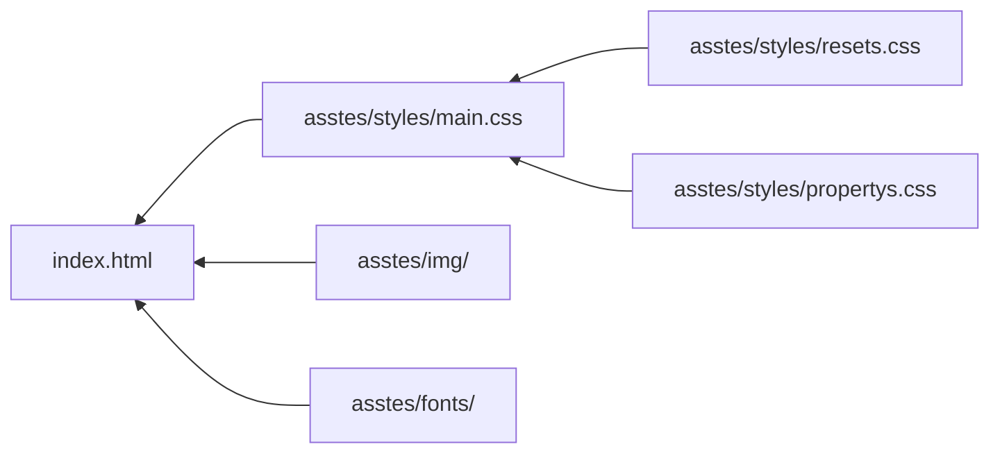

<h1 align="center">🤎 Tueste Lento</h1>

---

## 📋 Tabla de contenido

- [Introducción](#-introducción)
- [Descripción del proyecto](#-descripción-del-proyecto)
- [Características principales](#-características-principales)
- [Estructura del proyecto](#estructura-del-proyecto)
- [Cómo abrir el sitio](#cómo-abrir-el-sitio)
- [Secciones del sitio](#-secciones-del-sitio)
- [Tecnologías utilizadas](#tecnologías-utilizadas)
- [Diseño y estilos](#-diseño-y-estilos)
- [Personalización](#personalización)
- [Créditos](#-créditos)

## ☕ Introducción

*Tueste Lento* es una cafetería familiar que desde 2021 ofrece experiencias de
café, panadería y convivencia en un ambiente cálido, acogedor y pensado para
disfrutar cada momento.

## 📖 Descripción del proyecto

Tueste Lento es un sitio web para una cafetería contemporánea que busca
resaltar la calidez del café artesanal, la calidad de sus productos y la
experiencia de visitar un lugar pensado para relajarse y disfrutar. El proyecto
está desarrollado con HTML y CSS puro, con un enfoque en una interfaz limpia,
moderna y adaptable a distintos dispositivos.

La página presenta secciones de navegación, carta, ambiente, imágenes y
contacto, todo diseñado para transmitir una identidad visual acogedora y
premium. Además, la estructura del sitio está organizada con una metodología
clara y mantenible, priorizando la simplicidad, la legibilidad y una
experiencia visual agradable.

## ✨ Características principales

* Diseño moderno y minimalista con una estética cálida y premium.
* Menú de navegación responsive para una experiencia óptima en desktop y móviles.
* Secciones visuales destacadas para carta, ambiente y experiencia del cliente.
* Uso de imágenes cuidadosamente seleccionadas para reforzar la identidad de la marca.
* Estructura clara y reutilizable con clases BEM para facilitar mantenimiento del CSS.
* Enfoque en accesibilidad y simplicidad, sin depender de frameworks externos.
* Experiencia visual enfocada en la calidad del café y la sensación de tranquilidad.

## 🗂️ Estructura del proyecto

## ▶️ Cómo abrir el sitio

👉 [Ver el sitio web](https://mirodev20.github.io/tueste-lento/)

## 🧭 Secciones del sitio

- **Carta:** presenta la oferta de productos de Tueste Lento.
- **Comer:** destaca opciones de panadería y acompañamientos.
- **Beber:** muestra las bebidas y preparaciones de café.
- **Ambiente:** reúne imágenes del espacio y la experiencia de la cafetería.
- **Visítanos:** ofrece información para conocer y visitar el lugar.

## 🛠️ Tecnologías utilizadas

- **HTML5:** estructura y contenido del sitio.
- **CSS3:** presentación visual y adaptación a distintos tamaños de pantalla.
- **BEM:** metodología para organizar las clases CSS.
- **Git:** control de versiones del proyecto.
- **GitHub Pages:** publicación del sitio web.

## 🎨 Diseño y estilos

El diseño de *Tueste Lento* utiliza una paleta cálida inspirada en el café y en los tonos naturales de una cafetería. Los marrones aportan identidad y contraste; los tonos beige y crema crean una sensación acogedora, mientras que los colores neutros mantienen la lectura clara.

### Paleta de colores

| Color | Uso | Muestra |
| --- | --- | --- |
| Marrón café (`#7A4527`) | Botones, títulos y elementos principales |  |
| Marrones oscuros (`#643920`, `#55301B`) | Estados `hover` y `active` |   |
| Beige (`#E7DED2`) y crema (`#F7F0E6`) | Fondos de secciones y tarjetas |   |
| Blanco (`#FFFFFF`) | Superficies y paneles |  |
| Espresso (`#2B1A10`) | Fondos oscuros y titulares destacados |  |
| Tonos de texto (`#3A2A20`, `#4A3A2F`) | Texto principal y secundario |   |
| Bordes (`#CDBFAE`, `#DDD3C6`) | Separación sutil entre elementos |   |
| Marrón suave (`#8A6A55`) | Detalles decorativos, como los puntos guía de la carta |  |

Los colores están definidos como propiedades personalizadas de CSS para facilitar su reutilización y mantenimiento.

## 🖌️ Personalización

Como parte de una futura iteración, me gustaría renovar la identidad visual del sitio:

- **Imágenes:** reemplazar las fotografías actuales por ilustraciones o recursos gráficos inspirados en el estilo *Corporate Memphis*, procurando mantener una estética coherente en todo el sitio.
- **Tipografías:** explorar otras familias tipográficas que complementen la paleta de colores y refuercen la personalidad de la marca.
- **Coherencia visual:** ajustar colores, tamaños y composición de los elementos para que las imágenes y las tipografías elegidas funcionen en conjunto.

## 🙌 Créditos

Agradezco a **[AlexCG Design](https://www.youtube.com/@AlexCGDesign)** por sus tutoriales y enseñanzas, que me ayudaron a aprender y desarrollar este proyecto.
