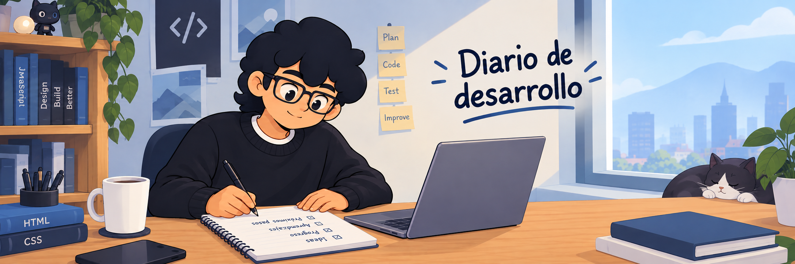
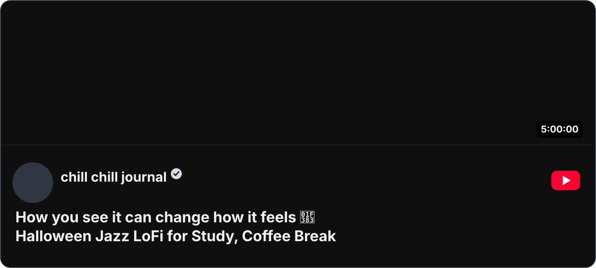
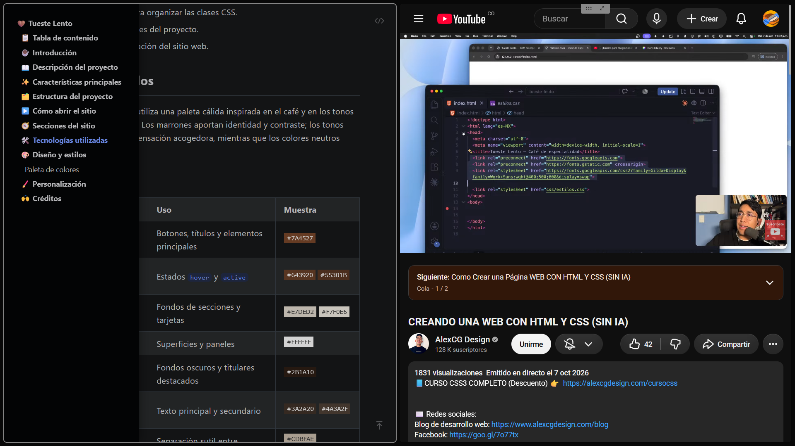

<h1 align="center">☕ Journal</h1>

En esta ocasión estoy realizando un proyecto únicamente con HTML y CSS, siguiendo
el tutorial del canal [AlexCG Design](https://www.youtube.com/@AlexCGDesign), el cual fue transmitido en directo:

[CREANDO UNA WEB CON HTML Y CSS (SIN IA)](https://www.youtube.com/watch?v=jt6z1c7IanQ)

Como es sencillo, creo que me lo tomaré con calma y escribiré lo máximo posible
sobre lo que pienso.

---

En el artículo [Desarrollo impulsado por README](https://tom.preston-werner.com/2010/08/23/readme-driven-development.html),
[Tom Preston-Werner](https://tom.preston-werner.com/) habla de algo llamado RDD[^1], un concepto que representa
una versión reducida de DDD[^2].

Consiste en escribir primero el `README.md` del proyecto para definir su propósito,
funcionamiento e interfaz antes de programarlo. Es similar a cuando usas TDD[^3]
y te das cuenta de todos los posibles errores que podría tener tu implementación.

Creo que aprovecharé que este proyecto es pequeño y lo pondré en práctica.

## 📅 2026/10/13 — Mi primera experiencia con Readme Driven Development

### 🎯 Objetivo de la sesión

**¿Qué quiero conseguir hoy y por qué?**

Quiero definir el `README.md` del proyecto antes de continuar con su desarrollo, aplicando RDD por primera vez. Así podré aclarar el propósito, las secciones y los requisitos de la página antes de escribir más HTML y CSS.

**Criterio de éxito:** Tener un `README.md` que explique claramente el objetivo del proyecto, sus características principales y la estructura inicial que seguirá la página.

### 🧭 Plan de trabajo

- [x] Revisar el tutorial y anotar las secciones que tendrá la página.
- [x] Escribir el propósito y las características principales en el `README.md`.
- [x] Revisar el documento para confirmar que sirve como guía antes de continuar programando.

### 🎧 Lo que escuché en la sesión

### 🛠️ Trabajo realizado

#### Lo que hice

- Redacté y organicé el `README.md` como guía del proyecto, con su descripción, características y secciones del sitio.
- Documenté la estructura de archivos con un diagrama Mermaid y anoté cómo visitar la versión publicada en GitHub Pages.
- Añadí las tecnologías utilizadas, la paleta de colores en una tabla con badges y las ideas futuras para personalizar imágenes y tipografías.
- Reconocí en los créditos a AlexCG Design, cuyo tutorial me sirvió como recurso de aprendizaje.

#### Decisiones técnicas

- **Decisión:** Escribir la documentación en Markdown y organizar la paleta en una tabla con badges de color.
- **Motivo:** Markdown permite mantener la guía junto al código en GitHub; la tabla facilita comparar los colores y entender para qué se usa cada uno.
- **Alternativas:** Podía dejar los colores como una lista de códigos hexadecimales, pero la tabla con muestras visuales hace la paleta más fácil de consultar.

#### Evidencia del progreso

##### `README.md`

### 🧠 Lo que aprendí

#### Concepto o habilidad principal

**RDD**

Aprendí a escribir primero el `README.md` del proyecto y así pensar sobre el
resultado que quiero conseguir antes de empezar a programar.

**¿Cómo funciona y por qué?**

La idea es definir primero, en el `README.md`, qué problema resuelve el proyecto,
qué ofrecerá y cómo se organizará. Al escribir esa guía antes del código puedo
aclarar mis objetivos, detectar información que falta y usarla como referencia
durante el desarrollo. No reemplaza las pruebas ni garantiza que el plan no
cambie, pero ayuda a empezar con una dirección más clara.

**¿Cómo lo apliqué?**

Antes de continuar con el HTML y CSS, documenté el propósito de *Tueste Lento*,
sus características y secciones. También describí las tecnologías, la
estructura de archivos, la paleta de colores y algunas ideas futuras para el
diseño. Así el `README.md` funciona como una primera especificación y como una guía
para revisar si el sitio que construya coincide con lo que me propuse.

**¿Qué todavía no entiendo del todo?**

Todavía quiero descubrir cómo mantener el README útil cuando el proyecto cambie:
qué detalles conviene actualizar en cada iteración y cómo evitar que la
documentación prometa funciones que aún no están implementadas.

#### Otros aprendizajes

- Aprendí a organizar la documentación con encabezados, listas, enlaces y tablas
  de Markdown.
- Usé Mermaid para representar de forma visual las relaciones entre el HTML,
  las hojas de estilo y los recursos del proyecto.
- Los badges permiten mostrar muestras de color directamente en una tabla, lo
  que hace la paleta más fácil de consultar.

#### Recursos consultados

- [Desarrollo impulsado por README](https://tom.preston-werner.com/2010/08/23/readme-driven-development.html) — me introdujo al concepto de RDD y a la idea de definir el proyecto en el README antes de implementarlo.
- [Tutorial de AlexCG Design](https://www.youtube.com/watch?v=jt6z1c7IanQ) — seguimiento del tutorial de HTML y CSS que inspiró el proyecto.

### 🚧 Dificultades y experimentos

#### Problema o pregunta

Me costó expresar con claridad lo que tenía en mente. A veces me faltaban las
palabras o el vocabulario para describir mis ideas. También me resultó difícil
definir la organización, la función y el propósito de un proyecto cuya estructura
ya estaba planteada en un tutorial. Como era mi primera experiencia con RDD,
tardé bastante en completar el README.

**Qué intenté:**

- Escribí ideas sueltas y aproximaciones de lo que quería decir en GitHub Copilot
  y le pedí ayuda para desarrollarlas.
- Revisé las propuestas y las fui usando para construir y organizar el README
  del proyecto.

**Qué ocurrió:**

Con ayuda pude convertir varias ideas iniciales en secciones y textos más
completos. El proceso tomó tiempo y requirió revisar el contenido para que
representara lo que quería comunicar sobre el proyecto.

**Causa identificada:**

No puedo asegurar una causa única. Creo que influyeron tanto la poca práctica
que tengo expresando mis ideas por escrito como el reto de aplicar RDD a un
proyecto guiado por un tutorial, en el que parte de la organización ya estaba
definida.

**Solución o conclusión:**

Me apoyé en GitHub Copilot para desarrollar mis ideas, pero el contenido partió
de mis propias observaciones y decisiones. Esta primera experiencia no tuvo que
ser una aplicación perfecta de RDD: me permitió practicar el enfoque y
comprender mejor cómo usar el README para aclarar lo que quiero construir.
Quiero escribir más, sobre cualquier tema, para practicar cómo expresar y
desarrollar mis ideas.

**Estado:** Parcialmente resuelto; completé el README, pero quiero seguir
practicando la expresión escrita y el uso de RDD.

### 🧪 Comprobación del resultado

**¿Cómo comprobé que funciona?**

- [x] Abrí el README en GitHub y revisé que el formato Markdown se renderice correctamente.
- [x] Comprobé que los enlaces de la tabla de contenido lleven a sus secciones.
- [x] Verifiqué que el diagrama Mermaid y la tabla de colores se vean correctamente.
- [x] Abrí los enlaces externos y confirmé que apuntan a los recursos correctos.
- [x] Comprobé que las rutas y nombres de archivos coincidan con la estructura real del proyecto.
- [x] Comparé las características descritas con lo que el sitio realmente ofrece.
- [x] Abrí el enlace de GitHub Pages y confirmé que el sitio publicado carga correctamente.
- [x] Revisé la ortografía y la claridad de los textos.

**Resultado observado:** El README se muestra correctamente en GitHub; la tabla
de contenido, el diagrama Mermaid, la paleta y los enlaces se pueden consultar.
La documentación ya sirve como guía inicial, aunque habrá que contrastarla con
el sitio a medida que avance su desarrollo para mantenerla fiel a lo implementado.

### 🌱 Reflexión de aprendizaje

- **Ahora puedo:** explicar la idea de RDD y usar un README para ordenar el
  propósito, las características y la estructura inicial de un proyecto.
- **Lo que más me costó:** encontrar las palabras para expresar mis ideas y
  definir el proyecto aunque partiera de un tutorial ya existente.
- **Qué haría diferente:** reservar más tiempo para escribir mis propias ideas
  primero y después pedir ayuda para revisarlas y organizarlas.
- **Cómo puedo reutilizarlo:** actualizar el README conforme implemente cada
  parte del sitio y aplicar este enfoque al iniciar otros proyectos.

### ✅ Cierre de la sesión

**Resultado concreto:** quedó redactado y publicado en GitHub un README que
documenta el propósito, las características, la estructura, las tecnologías y
la identidad visual prevista para *Tueste Lento*.

**Estado del proyecto tras la sesión:** el README está disponible y el sitio
puede visitarse en GitHub Pages. El desarrollo continuará siguiendo el tutorial;
la documentación deberá actualizarse para reflejar los cambios reales.

**Deuda técnica o mejora futura:** reemplazar la imagen de portada pendiente y
revisar el diagrama Mermaid y las descripciones cuando cambie la estructura o
se implementen nuevas funciones.

### 👣 Próximos pasos

- [ ] Continuar el desarrollo de la página siguiendo el tutorial de AlexCG Design.
- [ ] Actualizar el README cuando las secciones y funciones estén implementadas.

**Próximo objetivo de aprendizaje:** practicar HTML y CSS mientras comparo la
implementación con los objetivos que definí en el README.

**Punto de reanudación:** continuar con la estructura y los estilos de la
página en `index.html` y los archivos CSS.

[^1]: Readme Driven Development
[^2]: Domain Driven Design
[^3]: Test Driven Development
